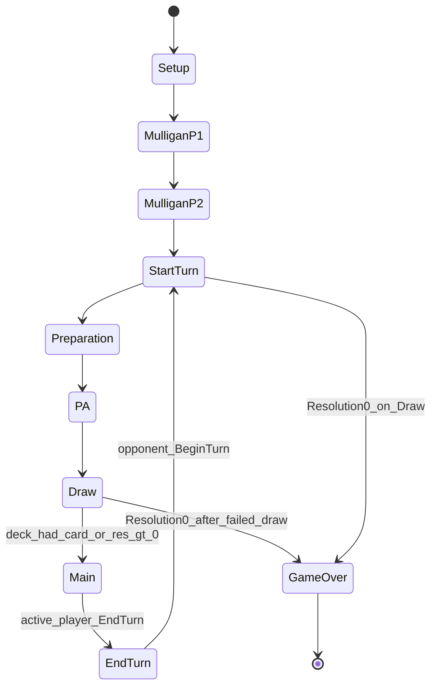

# Sprint 1 — Architecture: State Machine

- Date: 2026-09-04
- Scope: Sprint 1 turn / mulligan cycle only
- Engine enums: `MatchPhase` in Domain; prompt labels MulliganP1/P2 map to seats

## Prompt ↔ engine mapping

| Prompt / review label | Engine |
| --- | --- |
| MulliganP1 | `MatchPhase.MulliganP0` (seat `PlayerId.Player0`) |
| MulliganP2 | `MatchPhase.MulliganP1` (seat `PlayerId.Player1`) |
| StartTurn | Not a `MatchPhase`. `TurnCycle.BeginTurn` emits `TurnStarted`, then walks automatic phases |
| EndTurn | Player command `CommandType.EndTurn` in `Main`; emits `TurnEnded`, enters `Closing`, then opponent `BeginTurn` |
| PA | `MatchPhase.Pa` |
| Draw | `MatchPhase.Draw` |
| Main | `MatchPhase.Main` (decision point) |
| GameOver | `MatchPhase.GameOver` |

Mulligan order follows **seat index** (P0 then P1), not first-player order. After both mulligans, the first `BeginTurn` uses `FirstPlayerId` chosen at `CreateMatch`.

## Sprint 1 flow (Mermaid)

Notes:

- `Setup` is brief during `CreateMatch` (instantiate, shuffle, deal, choose first player), then the public phase becomes `MulliganP0`.
- Automatic phases (`Preparation`, `Pa`, `Draw`, `Closing`) run inside `TurnCycle.AdvanceUntilDecision` with no coroutines / `Update`.
- **GameOver by Resolution 0** happens in **Draw**: empty deck → `DrawFailed` → `ResolutionRemoved` → if Resolution is 0, match ends (`MatchEndCause.ResolutionDepleted`) and does **not** enter Main.
- After a legal `EndTurn`, `Closing` resets free reorganization and immediately starts the opponent’s turn (`StartTurn` path above). GameOver on that path only if the opponent’s Draw depletes Resolution.

## Decision points (Sprint 1)

| Phase | Legal actions |
| --- | --- |
| MulliganP0 / MulliganP1 | `ConfirmMulligan` KeepHand or ReplaceWholeHand for that seat |
| Main | `EndTurn` for `ActivePlayerId` only |
| GameOver | none |

## Global turn index

`GameState.Turn` is the global turn counter. After both mulligans, turn 1 is the first `BeginTurn`. After five accepted `EndTurn` commands, `Turn == 6` because the sixth `BeginTurn` has already run.
